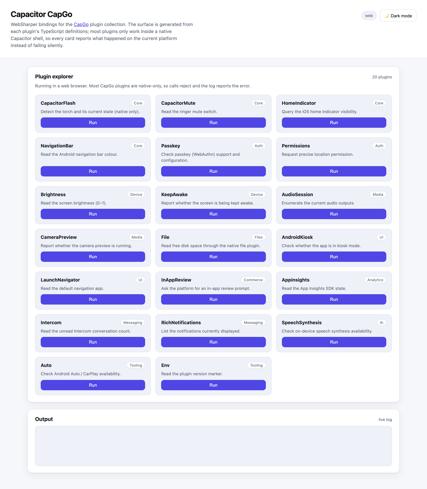

# WebSharper Capacitor CapGo

[](https://www.nuget.org/packages/WebSharper.Capacitor.CapGo)

F# bindings for the [CapGo](https://capgo.app/) Capacitor plugin collection, for use with
[WebSharper](https://websharper.com/). They let you build cross-platform web, Android and iOS
apps in F# on top of CapGo's plugins.

The surface is **generated** from each plugin's published TypeScript declarations
(`tools/extract.mjs` → `tools/model/*.json` → `CapGoGeneratorCommon`), so the bindings track
upstream instead of drifting: 148 plugins across 11 packages, typed method-by-method.

## Live demos

**Try it live:** [Open the sample in your browser](https://dotnet-websharper.github.io/Capacitor.CapGo/)



The sample doubles as the binding's [test case](#running-the-test-case): one demo per family
package, calling the real plugin API and reporting the outcome — or the native-only error —
instead of failing silently.

## Packages

Each family ships as its own package so a small app only installs the npm packages it uses.

| Package | Plugins | Examples |
|---|---:|---|
| `WebSharper.Capacitor.CapGo` | 17 | updater, social-login, native-purchases, data-storage-sqlite, uploader, downloader, navigation-bar, native-audio |
| `WebSharper.Capacitor.CapGo.Auth` | 21 | passkey, native-biometric, app-attest, permissions, ssl-pinning, nfc |
| `WebSharper.Capacitor.CapGo.Media` | 16 | audio-recorder, audio-session, camera-preview, document-scanner, pdf-generator |
| `WebSharper.Capacitor.CapGo.Files` | 8 | file, file-picker, file-sharer, zip, asset-cache, fast-sql |
| `WebSharper.Capacitor.CapGo.Device` | 27 | accelerometer, pedometer, bluetooth-low-energy, health, screen-orientation, contacts |
| `WebSharper.Capacitor.CapGo.UI` | 16 | inappbrowser, native-navigation, date-picker, pretty-toast, kiosk |
| `WebSharper.Capacitor.CapGo.Commerce` | 7 | pay, stripe-*, admob, in-app-review |
| `WebSharper.Capacitor.CapGo.Analytics` | 20 | firebase-* (9), appsflyer, rudderstack, gtm, supabase |
| `WebSharper.Capacitor.CapGo.Messaging` | 9 | notifications, rich-notifications, twilio-voice, stream-call, intercom |
| `WebSharper.Capacitor.CapGo.AI` | 3 | llm, speech-recognition, speech-synthesis |
| `WebSharper.Capacitor.CapGo.Tooling` | 4 | env, sim, live-reload, auto |

The full roster — package, current npm version, method/event counts and any known gap — is in
[`tools/coverage.md`](tools/coverage.md).

Plugin types live under `WebSharper.Capacitor.CapGo.<Plugin>`; each package also exposes a root
class (`CapacitorCapGo`, `CapacitorCapGoAuth`, `CapacitorCapGoMedia`, …) with one property per
plugin, mirroring how the official `WebSharper.Capacitor` binding is used.

## Install

```sh
dotnet add package WebSharper.Capacitor.CapGo        # or one of the family packages
```

Install the npm plugin you actually use in your Capacitor app:

```sh
npm i @capgo/capacitor-flash
npx cap sync
```

The binding imports the plugin from its npm package, so the bundler resolves it; there is no
CDN script.

## Usage

```fsharp
open WebSharper
open WebSharper.JavaScript
open WebSharper.Capacitor.CapGo

[<JavaScript>]
let checkTorch () =
    promise {
        let! available = CapacitorCapGo.CapacitorFlash.IsAvailable()
        let! on = CapacitorCapGo.CapacitorFlash.IsSwitchedOn()
        return if available.Value then sprintf "torch on=%b" on.Value else "no torch"
    }
```

Method and event shapes follow the plugin's declaration: optional options objects, typed
`Promise<'T>` results, and one `AddListener` overload per event (the event name is a single-case
enum), e.g.:

```fsharp
let! _ =
    CapacitorCapGo.CapacitorUpdater.AddListener(
        CapacitorUpdater.CapacitorUpdaterDownloadEventName.download,
        fun (e: CapacitorUpdater.DownloadEvent) -> printfn "%d%%" e.Percent)
```

## Running the test case

```sh
dotnet build WebSharper.Capacitor.CapGo.Sample/WebSharper.Capacitor.CapGo.Sample.fsproj -c Release
dotnet serve -d WebSharper.Capacitor.CapGo.Sample/dist -p 8080
```

Install the `dotnet-serve` tool once with `dotnet tool install -g dotnet-serve`.

Most CapGo plugins are native-only: in a plain browser their calls reject and the sample's log
reports that. To exercise the native paths, run the bundled site inside a Capacitor shell:

```sh
cd WebSharper.Capacitor.CapGo.Sample
npm i @capacitor/core @capacitor/cli
npx cap add android   # or ios
npx cap sync
```

## Regenerating the bindings

The bindings are not hand-written. After an upstream release:

```sh
cd tools
npm install
node extract.mjs            # refreshes tools/model/*.json and tools/coverage.md
node sync-projects.mjs      # refreshes the npm pins and package templates
```

`node extract.mjs --check` exits non-zero when a committed model is out of date; that is the CI
guard. Anything the extractor cannot flatten (generic methods, hand-curated unions) lives in
`tools/overrides/*.json` and is listed under `unsupported` in the coverage table.

## Build from source

```sh
dotnet tool restore
dotnet paket install
dotnet build WebSharper.Capacitor.CapGo.sln -c Release
```

WebSharper 11 needs the .NET 11 runtime for `wsfsc`.

## Pack

```sh
WSPackageFolder=/tmp/pkg dotnet fsi ./build.fsx -t WS-Package
```

One `.nupkg` is produced per project (`nuget/*.paket.template`), all on the same version line.

## Deployment

`.github/workflows/ghpages.yml` builds the sample in Release (which runs `npm install` and
`vite build`) and publishes `WebSharper.Capacitor.CapGo.Sample/dist` to the `gh-pages` branch.
Enable Pages per repo with the `gh-pages` source.

## Repository layout

| Path | Purpose |
|---|---|
| `tools/` | d.ts extractor, JSON models, overrides, roster, project/template sync |
| `CapGoGeneratorCommon/` | model → WIG assembly (not packed) |
| `WebSharper.Capacitor.CapGo*/` | the binding packages (one per family) |
| `WebSharper.Capacitor.CapGo.Sample/` | SPA sample + Vite build + test case |
| `nuget/` | paket templates (one per package) |

## License

Apache 2.0 — see [LICENSE.md](LICENSE.md).